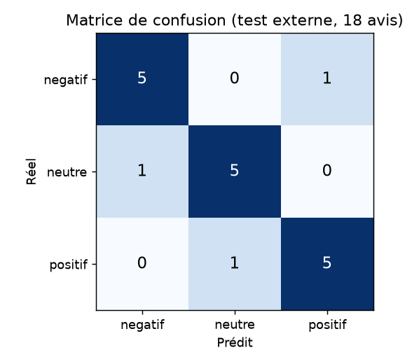
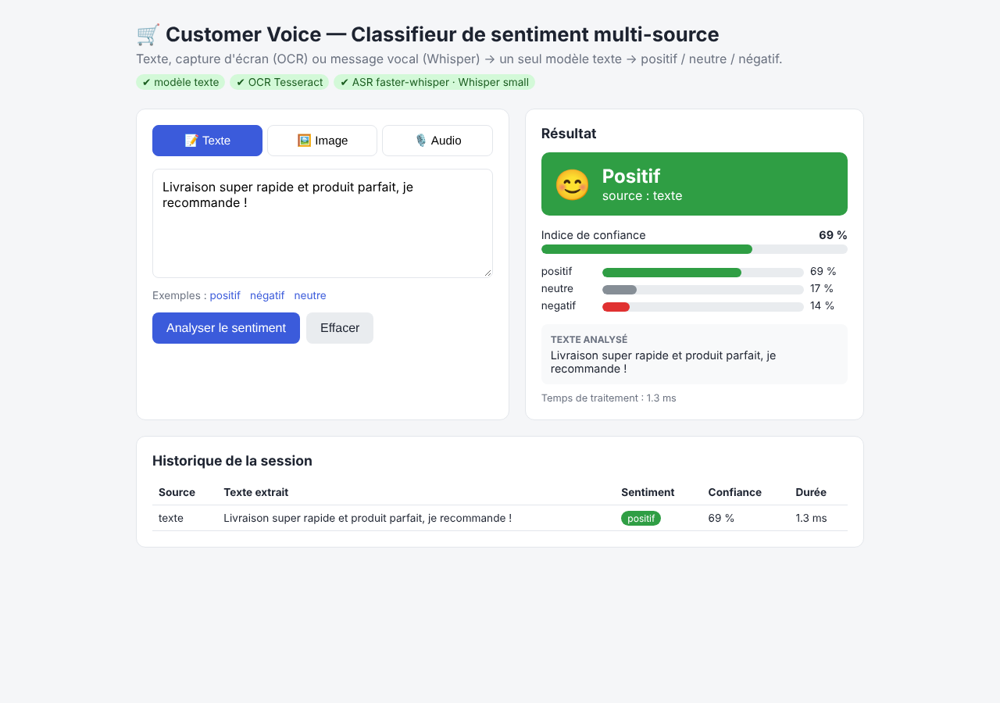
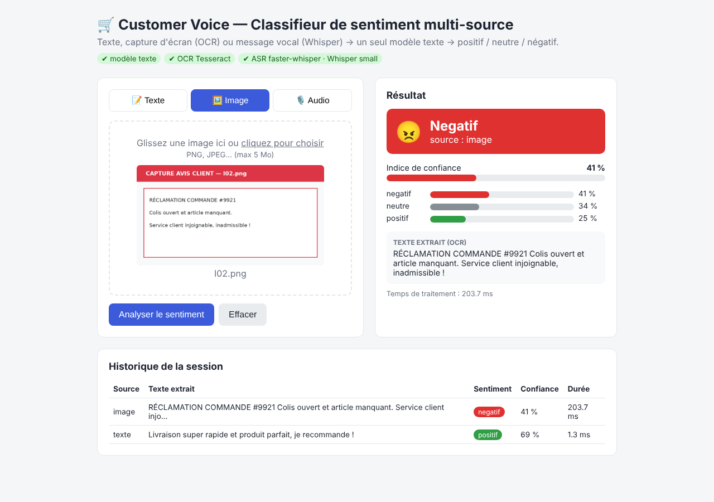
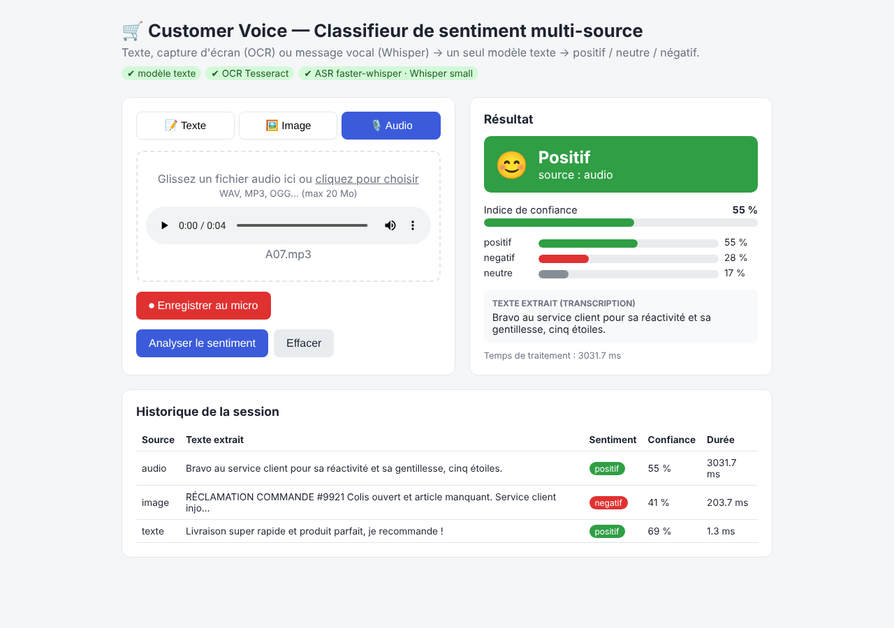
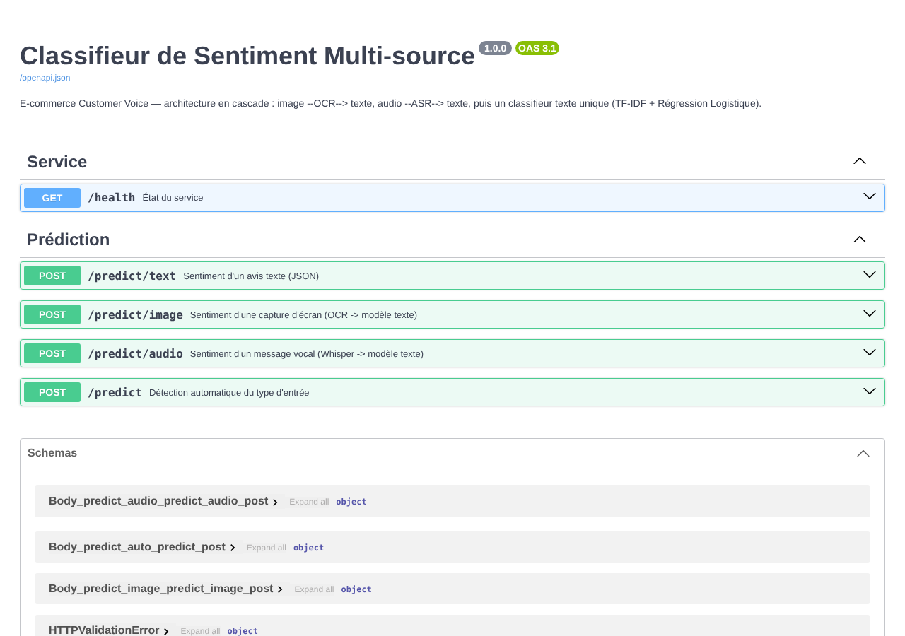
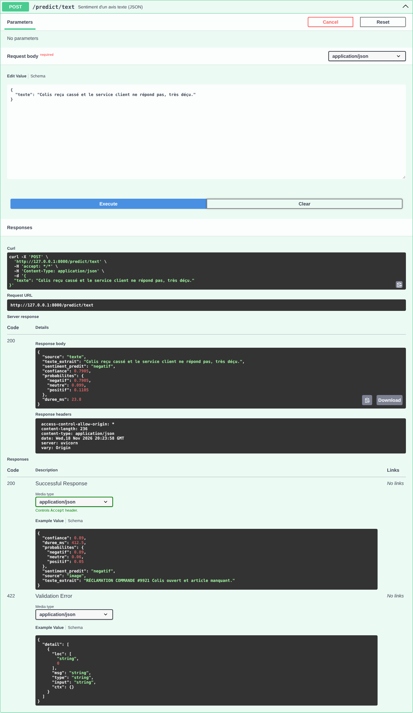
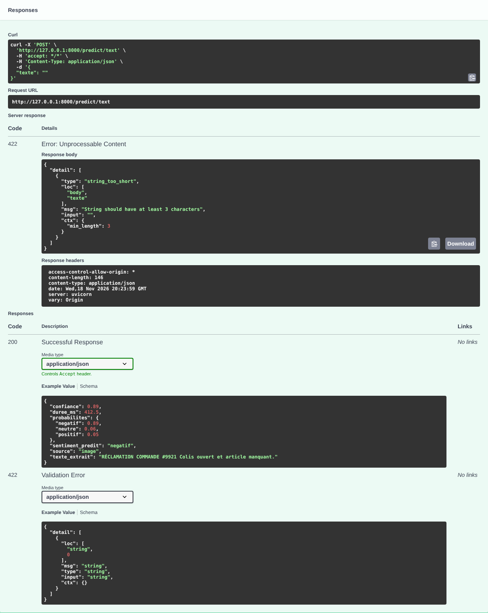

# Classifieur de Sentiment Multi-source — E-commerce Customer Voice

Mini-projet ML Appliqué 2026 — travail individuel.

Un système unique qui prédit le sentiment (**positif / neutre / négatif**) d'un avis client, quelle que soit sa forme : **texte**, **image** (capture d'écran, ticket scanné) ou **audio** (message vocal). Les prédictions sont exposées par une **API REST FastAPI** et testables depuis une **mini-application web**.

## Architecture en cascade

```
Texte ────────────────────────────────────────────┐
Image ──► OCR (Tesseract, pytesseract) ──► texte ─┼──► nettoyage ──► TF-IDF ──► Régression Logistique ──► JSON
Audio ──► ASR (Whisper)                ──► texte ─┘
```

Toutes les entrées sont ramenées à du texte : un seul classifieur prend la décision finale. La réponse JSON est la même pour toutes les routes :

```json
{
  "source": "image",
  "texte_extrait": "RÉCLAMATION COMMANDE #9921 Colis ouvert et article manquant. ...",
  "sentiment_predit": "negatif",
  "confiance": 0.41,
  "probabilites": {"negatif": 0.41, "neutre": 0.34, "positif": 0.25},
  "duree_ms": 203.7
}
```

## Structure du dépôt

```
projet_sentiment/
├── main.py                    # API FastAPI (routes /predict/*, /health, /app)
├── app/
│   ├── preprocessing.py       # nettoyage du texte (minuscules, stop-words, négations gardées)
│   ├── classifier.py          # chargement des .pkl + prédiction (cerveau commun)
│   ├── ocr.py                 # image -> texte (pytesseract + Pillow)
│   ├── asr.py                 # audio -> texte (faster-whisper ou openai-whisper)
│   └── schemas.py             # schémas Pydantic (entrées, fichiers, réponse)
├── scripts/
│   ├── train.py               # Étape 1 : entraînement + évaluation + sauvegarde .pkl
│   └── evaluer_pipelines.py   # évaluation OCR/ASR (WER, CER) + sentiment de bout en bout
├── models/                    # model.pkl, vectorizer.pkl, metrics.json
├── data/                      # dataset fourni (textes.csv, images/, audios/)
├── webapp/index.html          # mini-application web (HTML/JS, servie sur /app/)
├── tests/test_api.py          # 40 tests pytest
├── docs/captures/             # captures d'écran + matrice de confusion
├── requirements.txt
└── pytest.ini
```

## Installation

**1. Python 3.10 à 3.13** et un environnement virtuel :

```bash
python -m venv .venv
# Windows :
.venv\Scripts\activate
# Linux / macOS :
source .venv/bin/activate

pip install -r requirements.txt
```

**2. Tesseract OCR** (logiciel, pas une bibliothèque Python) :

- Windows : installeur UB-Mannheim (https://github.com/UB-Mannheim/tesseract/wiki). Pendant l'installation, cocher la langue **French**. Si `tesseract` n'est pas reconnu dans le terminal :
  ```bat
  set TESSERACT_CMD=C:\Program Files\Tesseract-OCR\tesseract.exe
  ```
- Linux : `sudo apt install tesseract-ocr tesseract-ocr-fra`

**3. Whisper** : rien à installer en plus avec `faster-whisper`. Le modèle (`small`, ≈ 480 Mo) est téléchargé automatiquement au premier appel audio, puis mis en cache. Pour un modèle plus léger : `set WHISPER_MODEL=base` (Windows) ou `export WHISPER_MODEL=base`.

## Utilisation

```bash
# 1) Entraîner le modèle texte (≈ 2 secondes) -> models/model.pkl + vectorizer.pkl
python scripts/train.py

# 2) (optionnel) Évaluer les pipelines OCR et ASR sur les 18 fichiers fournis
python scripts/evaluer_pipelines.py

# 3) Lancer l'API
uvicorn main:app --reload
```

| Adresse | Contenu |
|---|---|
| http://127.0.0.1:8000/app/ | Mini-application web (option B) |
| http://127.0.0.1:8000/docs | Documentation interactive Swagger (option A) |
| http://127.0.0.1:8000/redoc | Documentation ReDoc |
| http://127.0.0.1:8000/health | État du service |

Exemples en ligne de commande :

```bash
curl -X POST http://127.0.0.1:8000/predict/text -H "Content-Type: application/json" -d "{\"texte\": \"Colis reçu cassé, très déçu\"}"
curl -X POST http://127.0.0.1:8000/predict/image -F "file=@data/images/I05.png"
curl -X POST http://127.0.0.1:8000/predict/audio -F "file=@data/audios/A02.mp3"
curl -X POST http://127.0.0.1:8000/predict -F "file=@data/images/I08.png"
```

## Routes

| Méthode | Route | Entrée | Validation |
|---|---|---|---|
| POST | `/predict/text` | JSON `{"texte": "..."}` | 3 à 5000 caractères non vides |
| POST | `/predict/image` | `multipart/form-data`, champ `file` | PNG/JPEG/BMP/TIFF/WEBP, 5 Mo max |
| POST | `/predict/audio` | `multipart/form-data`, champ `file` | WAV/MP3/OGG/WEBM/FLAC/M4A, 20 Mo max |
| POST | `/predict` | champ `texte` **ou** champ `file` | type détecté par MIME |
| GET | `/health` | — | — |

Codes de réponse : `200` succès, `422` entrée invalide (champ manquant, mauvais type MIME, fichier vide/trop gros/corrompu, aucun texte détecté), `503` moteur OCR/ASR ou modèle absent.

## Tests

```bash
pytest -v                 # les 40 tests (dont 1 test lent avec le vrai Whisper)
pytest -v -m "not lent"   # sans le test Whisper réel
```

## Résultats

Classifieur texte entraîné sur les 24 avis de `textes.csv`, testé sur les 18 textes de référence des images et des audios (jamais vus à l'entraînement) :

| Mesure | Valeur |
|---|---|
| Accuracy (test externe, 18 avis) | **0,83** |
| F1-macro (test externe) | **0,83** |
| F1-macro validation croisée 4 plis × 10 (24 avis) | 0,24 ± 0,15 |

Pipelines complets (fichier -> extraction -> sentiment), `python scripts/evaluer_pipelines.py` :

| Source | WER moyen | CER moyen | Accuracy sentiment |
|---|---|---|---|
| Image (Tesseract) | 2,8 % | 0,9 % | 7/9 (0,78) |
| Audio (Whisper small) | 4,7 % | 1,0 % | 8/9 (0,89) |



## Captures d'écran

Mini-application web — texte, image, audio :





Swagger (`/docs`) — routes, essai de `/predict/text`, erreur 422 :





## Choix techniques (résumé)

- **TF-IDF (mots + bigrammes) + Régression Logistique** : rapide, interprétable, et donne des probabilités (champ `confiance`). Le SVM linéaire a été comparé (score équivalent) mais ne fournit pas de probabilités.
- **Négations conservées** dans le nettoyage (`ne`, `pas`, `sans`, `aucun`…) : elles inversent le sentiment.
- **Évaluation sur un test externe** : avec 24 exemples, la validation croisée est très instable ; les 18 textes de référence images/audios forment un jeu de test indépendant.
- **faster-whisper** plutôt qu'openai-whisper : même modèle Whisper, sans PyTorch ni ffmpeg, plus rapide sur CPU. openai-whisper reste supporté (`ASR_BACKEND=openai-whisper`).
- **Validation Pydantic** des types MIME et tailles, plus détection des fichiers corrompus.
- **Mini-app servie par FastAPI** (`/app/`) : un seul serveur à lancer, pas de problème de CORS.

## Limites

- 24 exemples d'entraînement : le modèle reconnaît surtout des mots déjà vus (« remboursement », « recommande », « conforme »). La confiance tourne autour de 40–70 %.
- Le fichier `audios.csv` mentionne des `.wav` alors que les fichiers fournis sont des `.mp3` : l'API accepte les deux.
- Les étoiles ★★★★★ ne sont pas lues correctement par Tesseract (I01.png).
